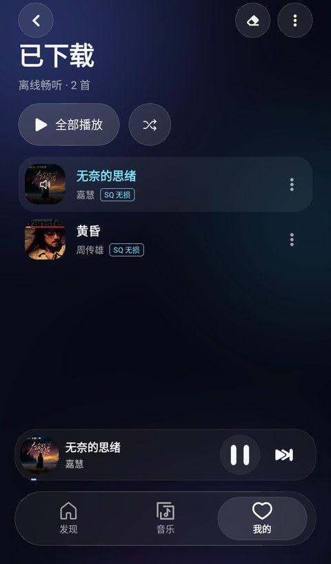
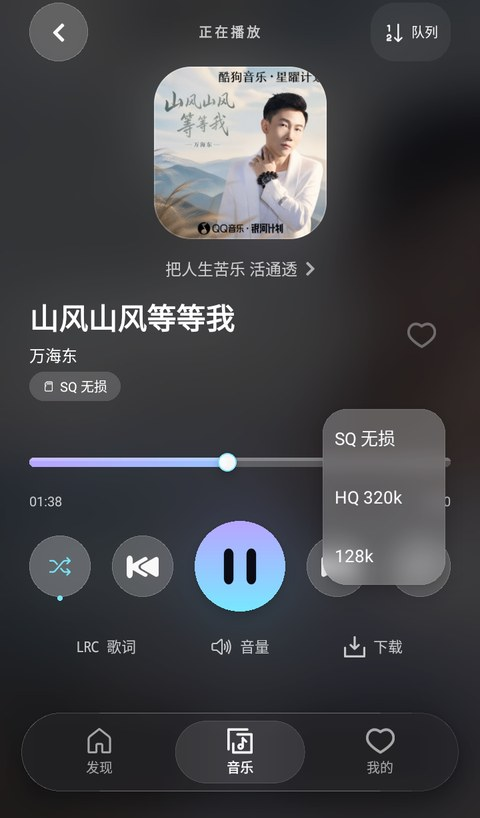
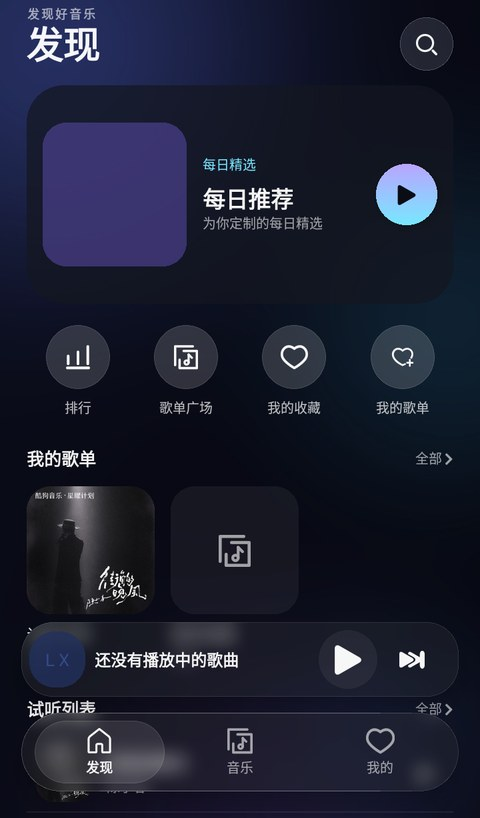
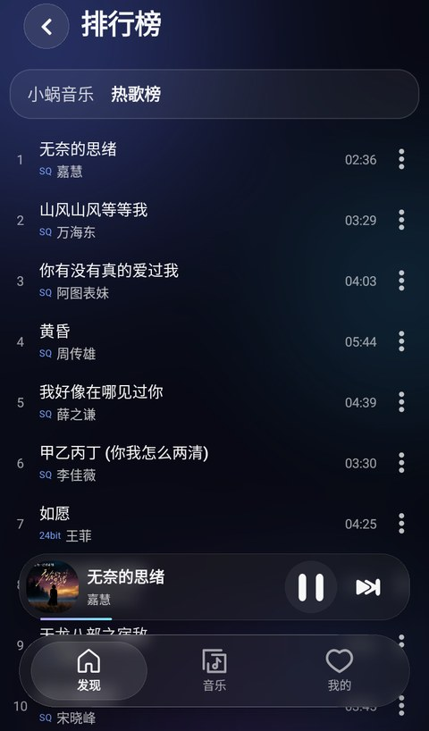
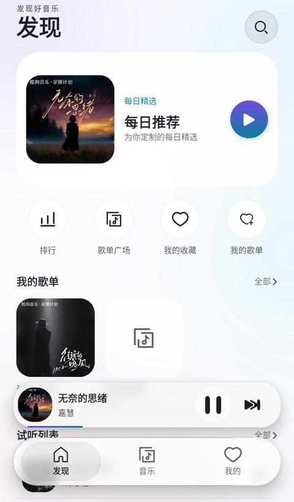
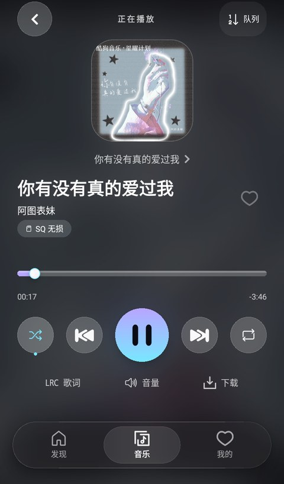
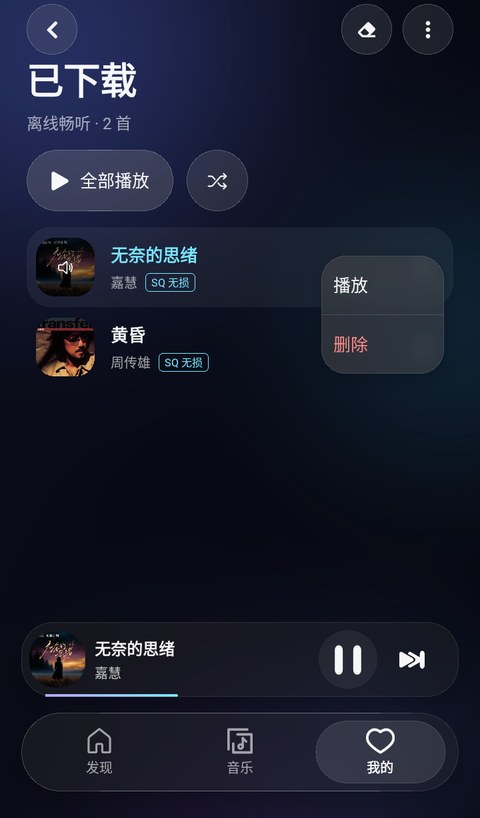

<div align="center">


# 洛雪音乐 · 液态玻璃版

**一个好看、能下载、装完就能听的手机音乐播放器**

<sub>基于开源项目 LX Music 重制的界面分支 · 沿用原版全部曲库能力</sub>

<br>


</div>

---

## 先说三个最实在的

### 一、歌曲能存进手机，断网也能听

这是这一版最花力气的功能。看到想留的歌，点一下「下载」，选个音质，它就从网上搬进你手机里了。

下载好的歌单独放在「已下载」页面。哪怕地铁没信号、飞机开了飞行模式，点开就能播 —— 不用等缓冲，不耗流量。

<div align="center">

<br>
<sub>「已下载」页：一个按钮播全部，也可以打乱顺序随便听</sub>
</div>

<br>

音质从 128k 到 SQ 无损都能选，最高能拿到录音室级别的文件。下载进度、速度、剩余大小都实时显示，下到一半关掉 App 也不怕，下次打开接着下。

<div align="center">

<br>
<sub>播放页直接点「下载」，三种音质任选</sub>
</div>

### 二、界面是真的好看

整个 App 用了同一种视觉语言：**液态玻璃**。

简单说，就是所有面板都像一块磨砂玻璃 —— 底下的内容隐隐透出来，边缘有一圈光，按钮像浮在玻璃上。配上深色背景和紫青渐变，晚上关灯听歌特别舒服。

这不是换张壁纸那种「美化」。每一个圆角、每一层模糊、每一处阴影都按同一套尺寸来，所以翻遍整个 App，风格是一致的，不会这里精致那里凑合。

<div align="center">
&nbsp;&nbsp;
<br>
<sub>左：发现页 &nbsp;|&nbsp; 右：排行榜，每个数字、每条分隔线都对得齐</sub>
</div>

### 三、白天也能用

不喜欢深色？设置里一键切浅色。

这不是简单把黑底换白底 —— 那样字会看不清。浅色版单独调过每一档文字的深浅，也单独调过玻璃的亮度和描边，所以在白底上一样清楚、一样有层次。

<div align="center">

<br>
<sub>浅色主题：冷白底 + 同一套玻璃质感</sub>
</div>

---

## 还有什么

| | |
| --- | --- |
| 📻 **排行榜** | 各大平台热歌榜，点开就听，顺手就能下 |
| 🎼 **歌单广场** | 按风格、场景挑歌单，不用自己一首首找 |
| ❤️ **收藏与歌单** | 喜欢的歌收进自己的列表，随时翻出来 |
| 🔍 **搜歌** | 搜歌名、搜歌手，多个来源一起找 |
| 🎤 **歌词** | 逐行滚动，支持翻译 |
| 🎚️ **音效调节** | 均衡器、播放速度，按耳机口味调 |
| ⏱️ **定时关闭** | 睡前听歌自动停，不怕放着放着一整夜 |

<br>

<div align="center">
&nbsp;&nbsp;
<br>
<sub>左：播放页，大封面 + 三个快捷操作 &nbsp;|&nbsp; 右：任意歌曲的更多操作</sub>
</div>

---

## 装到手机

### 直接安装

在 [Releases](../../releases) 页面下载 APK，传到手机点开装即可。

不知道选哪个？看这里：

| 你的手机 | 下载这个 |
| --- | --- |
| 绝大多数近几年的安卓机 | `arm64-v8a` |
| 比较老的机型（2016 年前后） | `armeabi-v7a` |
| 懒得判断 / 装到电脑模拟器 | `universal`（体积大一点，但都能装） |

> 首次安装会提示「来自未知来源」，允许一下就好。

### 自己编译

```bash
npm install

cd android
./gradlew assembleRelease
```

产出的安装包在 `android/app/build/outputs/apk/release/`。

编译需要自备签名文件：在 `android/` 下放 `keystore.properties` 和对应的 keystore。这两个文件不随仓库提供。

---

## 装了之后建议先做这件事

打开 **我的 → 设置 → 主题设置**，试试两个主题。

喜欢夜里听的留深色，白天用得多切浅色。切换是实时的，不用重启。

---

## 关于这个版本

本项目基于开源项目 [LX Music 移动版](https://github.com/lyswhut/lx-music-mobile) 重制。

**改了界面，没动能力。** 播放、搜索、歌单、音源这些核心功能全部沿用原版，重做的是外观和交互手感 —— 以及新加的下载功能。

当前版本 **1.9.6**。

---

## 一些你可能想知道的

<details>
<summary><b>为什么只有两个主题？</b></summary>

<br>

原版有十几套换色主题，但那套配色管不到新界面 —— 新界面用的是自己的一整套玻璃材质（固定底色、固定渐变、固定描边）。选中那些主题后画面几乎不变，等于给你十几个点了没反应的按钮。

所以这里只留两个真正生效的：深色和浅色。

</details>

<details>
<summary><b>下载的歌存在哪？</b></summary>

<br>

存在 App 自己的私有目录里，其他应用看不到，卸载 App 会一起清掉。

下载列表也会被记住 —— 重启手机、杀掉后台，再打开列表还在，不用重新下一遍。

</details>

<details>
<summary><b>为什么有的歌下不了？</b></summary>

<br>

能不能下、能下什么音质，取决于当前音源拿不拿得到那个文件。有些歌只有标准音质，有些干脆没有可用链接。

这是音源的问题，不是 App 的问题。

</details>

---

## 许可与免责

沿用上游 **Apache-2.0**，见 [`LICENSE`](./LICENSE)。以下为补充协议，如有冲突以此为准。

<sub>词语约定：「本项目」指 LX Music 移动版；「使用者」指使用本项目的人；「官方音乐平台」指本项目内置音源所对应的酷我、酷狗、咪咕等平台。</sub>

**一、数据来源**
本项目从各平台公开服务器拉取数据（与未登录状态在官方 App 看到的一致），筛选合并后展示，不对其合法性、准确性负责。
本项目本身不具备获取音频的能力。播放时，本项目只把歌名、歌手传给「音源」，音源返回什么链接就播什么，无法校验其正确性。因此可能出现想听的歌与实际播放的不一致、或无法播放的情况。

**二、版权数据**
使用过程中可能产生版权数据，本项目不拥有其所有权。为避免侵权，请务必在 **24 小时内**清除。

**三、平台别名**
本项目内对平台的称呼不含恶意。如平台认为不妥，可联系更改或移除。

**四、资源使用**
部分字体、图片等资源来自互联网，如有侵权可联系移除。

**五、免责**
因使用本项目产生的任何直接、间接、特殊、偶然或结果性损害，由使用者自行承担。

**六、使用限制**
本项目完全免费、开源，仅供技术学习交流，不对项目内技术是否违反当地法律法规作保证。
**禁止在违反当地法律法规的情况下使用。** 明知违法仍使用者，后果自负。

**七、版权保护**
音乐平台不易，请尊重版权，支持正版。

**八、非商业**
仅用于技术可行性探索与研究，不接受任何商业合作及捐赠。

**九、接受协议**
使用本项目即代表接受本协议。

---

<div align="center">
<sub>如有疑问：lyswhut+qq.com（把 <code>+</code> 换成 <code>@</code>）</sub>
</div>